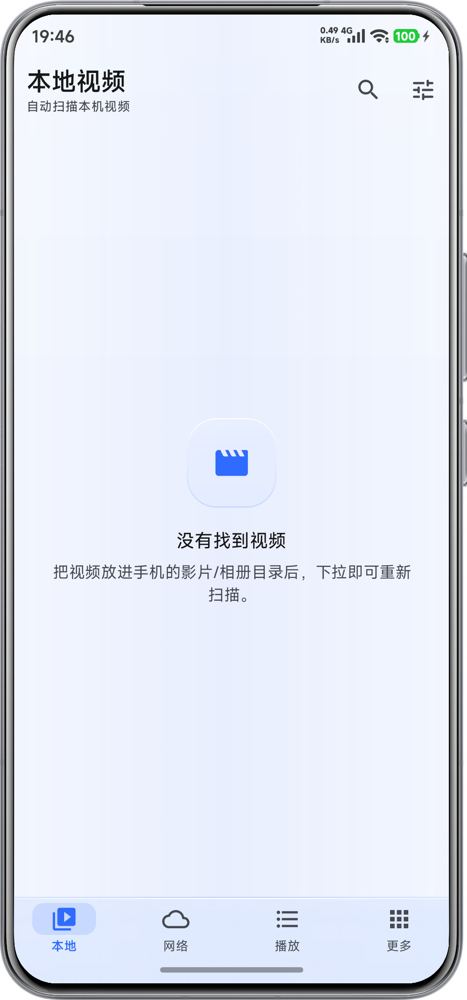
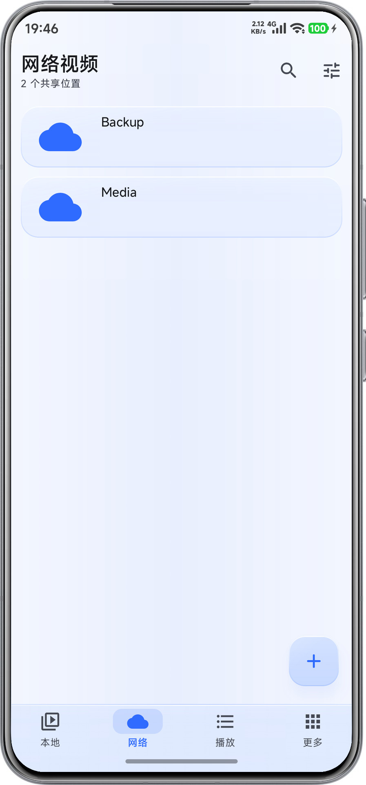
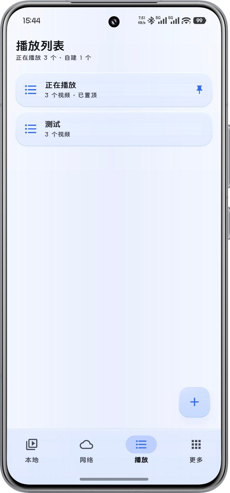
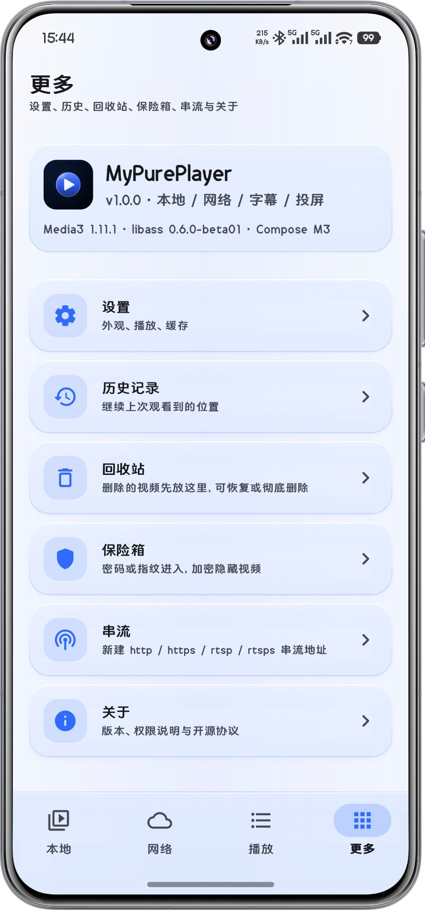
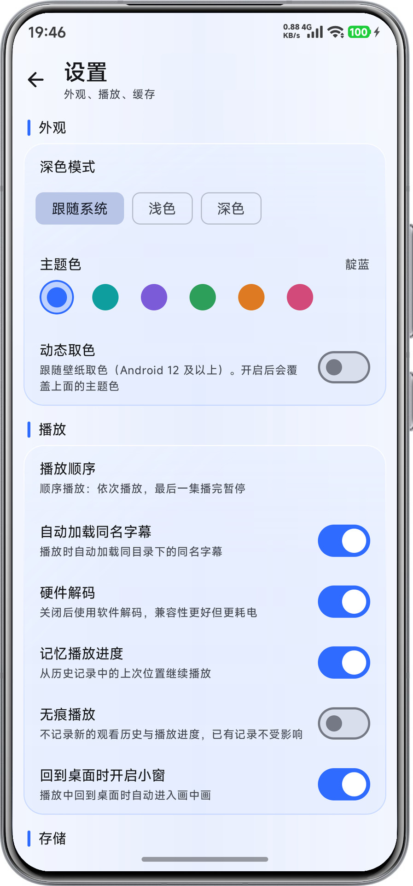
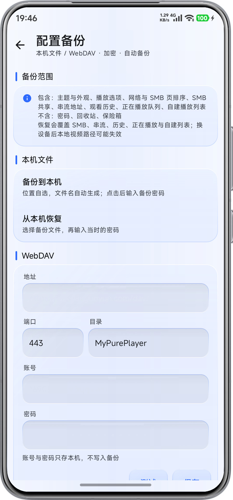

# MyPurePlayer

MyPurePlayer 是一个只做视频播放的 Android 客户端，使用 Kotlin + Jetpack Compose 实现。本地视频、SMB 网络共享、串流地址在同一套界面里统一浏览与播放，复杂 ASS 字幕由 libass 完整渲染。

- 项目名：`MyPurePlayer`
- 包名：`com.yaoahos.mypureplayer`
- 当前版本：`1.0.4`（versionCode 5）
- 最低系统：Android 7.0（API 24）
- 编译 SDK：Android SDK Platform 37；目标 SDK：Android 16（API 36）
- 发布资产：`MyPurePlayer-1.0.4-release.apk`
- 发布下载：[Releases](https://github.com/yaoahos/MyPurePlayer/releases)

> 本项目为独立开发的播放器，与任何品牌厂商均无关联。

---

## 界面预览

| 本地视频                                   | 网络视频                                     | 播放列表                                      |
|:------------------------------------------:|:--------------------------------------------:|:---------------------------------------------:|
|  |  |  |

| 更多                                  | 设置                                      | 备份                                        |
|:-------------------------------------:|:-----------------------------------------:|:-------------------------------------------:|
|  |  |  |

---

## 一、软件介绍

MyPurePlayer 面向「视频存放在本机或局域网共享中」的用户。它不注册账号、不接入统计与广告 SDK，网络共享只读，播放时不改写远程文件。

设计目标：

1. **一种播放体验**：本地文件、SMB 共享、串流地址走同一个播放页，字幕、音轨、倍速、投屏的操作完全一致。
2. **字幕不将就**：ASS/SSA 交给 libass 渲染，样式、动画、卡拉OK与内嵌字体都按原片呈现，不是只取纯文本。
3. **少跳页**：选字幕、查信息、切音轨都在播放页内的浮层完成，不会因为打开一个目录把屏幕转成竖屏再转回来。
4. **直连网络**：SMB 浏览与播放都在设备与共享服务器之间完成，不经第三方中转。
5. **克制**：只保留视频需要的权限与开关，界面文案统一简体中文。

---

## 二、功能一览

**本地视频**

- 首次启动扫描 MediaStore，首页按文件夹浏览、进入文件夹后列出视频。
- 宫格与列表两种视图：宫格按屏宽自适应列数（手机竖屏 4 列，平板与横屏更多）、缩略图铺满卡片；列表显示时长、大小与观看进度。
- 按名称、时长、大小、修改时间排序，支持搜索；手机与平板、横竖屏自适应列数。
- 长按操作：播放、加入播放列表、重命名、复制、移动、分享、信息、隐藏到保险箱、删除到回收站。

**网络共享**

- SMB v2/v3 服务器增删改与测试连接，地址栏可直接粘贴带路径的完整地址。
- 目录浏览、宫格与列表切换、排序、搜索、下拉刷新。
- 只读：只能播放与加入播放列表，不提供上传、删除、改名。
- 视频同名字幕自动下载缓存后挂载；也可在播放页内浏览任意网络目录挑字幕。
- 网络目录与缩略图均带缓存，进出文件夹即时显示。

**播放与字幕**

- 打开视频时把同目录全部视频加入播放列表，播完自动下一集。
- 按视频实际方向自动横竖屏；本地文件带尺寸信息可立即按目标方向显示，网络与串流先按横屏进入、解码后再纠正。
- 手势：单击显示/隐藏控件、双击暂停、左右滑快进快退、左侧滑亮度、右侧滑音量、长按 2 倍速。
- 字幕与音轨面板（横屏为右侧栏、竖屏为底部面板），支持外挂 SRT/ASS/SSA 与内嵌轨道。
- ASS/SSA 由 libass 完整渲染；本地同名字幕自动发现，网络字幕先取回缓存。
- 倍速、画面比例、硬解/软解切换、画中画、后台音频、DLNA / UPnP 投屏。
- 控制条在起播前就显示总时长，加载中也能看到片长与当前位置。

**播放列表与历史**

- 播放列表持久化，重启后恢复；「正在播放」详情页顶部显示当前视频与实时进度。
- 历史记录保存进度与元信息，可从上次位置续播。

**界面与交互**

- 四个底栏页支持左右滑动切换，两端自动停止；进入文件夹、选择态或内层页面时手势自动禁用。
- 玻璃材质弹窗与面板在手机、平板、横屏下统一限宽居中。

**更多与安全**

- 回收站：删除的本地视频先放入应用私有目录，可恢复或彻底删除。
- 保险箱：4–20 位密码（PBKDF2）+ 指纹双通道进入，视频信封加密存放，媒体库与文件管理器均不可见。
- 串流地址支持 http / https / rtsp / rtsps（含 HLS / DASH）。
- 配置可加密备份到本机或 WebDAV：云端按设备各存一份（设备名 + 4 位短码），支持定时自动上传，恢复时可选择其他设备的备份。
- 关于页集中版本、权限说明、开源协议与更新（启动时检查、检查更新、更新日志）。

---

## 三、技术选型

| 层次       | 选型                              | 说明                                             |
| ---------- | --------------------------------- | ------------------------------------------------ |
| 语言       | Kotlin 2.4.21                     | 协程 + Flow 驱动状态                             |
| UI         | Jetpack Compose + Material 3      | 声明式界面，手机与平板共用                       |
| 构建       | Gradle 9.9.1 + AGP 9.5.1          | JDK 17 字节码，R8 压缩与资源裁剪                 |
| 播放内核   | Jetpack Media3 / ExoPlayer 1.11.1 | 支持 HLS / DASH / RTSP 与多音轨                  |
| 媒体会话   | Media3 MediaSessionService        | 通知、锁屏、蓝牙耳机与系统媒体卡片由库托管       |
| 字幕渲染   | ass-media 0.6.0-beta01（libass）  | OVERLAY_OPEN_GL 叠加渲染 ASS/SSA                 |
| 网络共享   | smbj 0.15.0                       | 纯 Java SMB2/SMB3，单连接多路复用并发读          |
| 本地流服务 | HTTP Range 服务（随机 token）     | 给播放器、抽帧与 DLNA 投屏提供可拖动进度的数据源 |
| 存储       | JSON 文件 + DataStore             | 服务器、历史、队列、串流与设置，不引数据库       |
| 凭据加密   | Android Keystore AES-GCM          | SMB 口令与保险箱密钥                             |

---

## 四、安全与隐私

- SMB 口令落盘前用 Keystore 派生密钥（AES-GCM）加密，配置文件里只有密文。
- 保险箱文件带 HMAC-SHA256 校验，可检测篡改；数据密钥由密码派生密钥与 Keystore 双因子包裹。
- `android:allowBackup="false"`，避免凭据经系统备份外泄。
- DLNA 设备发现与控制使用局域网明文协议，因此应用全局放行明文流量；更新检查强制 HTTPS，WebDAV 支持 http / https（用 http 时会提示明文风险）。
- 本地流服务带 128 位随机 token 鉴权，监听所有网卡以便局域网投屏访问；token 不写入日志。
- 更新检查全程 HTTPS、主机名精确白名单；下载的安装包比对内置官方证书 SHA-256 指纹后才交给系统安装器。
- 不接入统计、广告、崩溃上报 SDK，不申请与播放无关的权限。

---

## 五、项目构建

**环境要求**：JDK 17；Android SDK Platform 37；Gradle 9.9.1。

**正式构建**：

```
./gradlew :app:assembleRelease
```

产物：`app/build/outputs/apk/release/MyPurePlayer-<版本号>-release.apk`。

**调试构建**：

```
./gradlew :app:assembleDebug
```

产物：`app/build/outputs/apk/debug/MyPurePlayer-<版本号>-debug.apk`。

调试包是**另一个应用**，不是正式版的另一个版本：包名 `com.yaoahos.mypureplayer.debug`、桌面名称「MyPurePlayer 调试版」、debug 证书签名。因此两者可以同时安装、互不覆盖，验证新改动不必先卸载正式版。代价是数据目录独立——设置、网络位置、播放列表、播放历史与缩略图缓存都不共享，调试包需要重新配置一遍。

**项目结构**：

```
MyPurePlayer/
├── app/
│   ├── build.gradle.kts                 版本号、依赖、R8 与 ABI 配置
│   ├── proguard-rules.pro               混淆保留规则（smbj / libass / 序列化）
│   └── src/main/
│       ├── AndroidManifest.xml          权限、Activity、前台服务
│       ├── assets/updateLog.md          应用内「更新日志」数据源
│       ├── java/com/yaoahos/mypureplayer/
│       │   ├── App.kt / MainActivity.kt 应用入口、权限请求、主题
│       │   ├── core/                    扩展名白名单与格式化
│       │   ├── data/                    模型、JSON 存储、MediaStore 扫描、SMB、更新检查
│       │   ├── media/                   缩略图抽帧与缓存、音轨语言读取
│       │   ├── playback/                ExoPlayer 控制器、媒体会话、DLNA 投屏与流服务
│       │   └── ui/                      导航、页面、组件与主题
│       └── res/                         图标、配色、字符串、网络安全配置
├── docs/screenshots/                     README 界面预览图
├── CHANGELOG.md                         全量版本日志（唯一权威记录）
├── LICENSE
└── README.md
```

**模块职责**：

- `ui/`：`AppNav.kt` 负责路由与底栏，`local/` `network/` `play/` `more/` `player/` 按页面拆分，`components/` 放卡片、下拉刷新、对话框等复用件。
- `playback/`：`Playback.kt` 是唯一的播放状态源（队列、轨道、进度、投屏），界面只读状态与调用方法。
- `media/`：`Thumbnails.kt` 负责抽帧、分辨率分档、磁盘缓存与时长回填。
- `data/`：`Graph` 汇总各仓储，`JsonStore` 用临时文件 + rename 原子写。

---

## 六、兼容性与限制

- 仅支持 Android 7.0 及以上，且只打包 arm64-v8a。
- SMB 需与 NAS 在同一局域网并开放 445 端口，使用 SMB2 / SMB3 协议。
- SMB 必须填写共享名：协议本身不提供共享列表，客户端必须先知道要进哪个共享。
- 网络缩略图与时长首次需要读一次远端文件，大目录里靠后的卡片会稍晚出图。
- 文件夹里点视频始终从头播放，只有历史记录页会带上次位置续播。
- 历史记录只保存进度与元信息，源文件被移动或删除后条目会播放失败。
- 投屏依赖局域网内设备支持 DLNA / UPnP，公网地址的 SSDP 应答一律拒绝。

---

## 七、开源致谢

MyPurePlayer 建立在这些开源项目之上，感谢它们的作者与维护者：

- **Jetpack Media3 / ExoPlayer**（Apache-2.0）— 播放内核与媒体会话
- **ass-media / libass**（LGPL-2.1+）— ASS/SSA 字幕排版与渲染
- **smbj**（Apache-2.0）— SMB2/SMB3 协议实现，单连接多路复用
- **AndroidX / Jetpack Compose / Material 3**（Apache-2.0）— 界面框架与组件
- **Kotlin / Coroutines / kotlinx.serialization**（Apache-2.0）— 语言与异步、序列化运行时
- **FFmpeg 6.1.1**（LGPL-2.1+）— DTS / DTS-HD / TrueHD 音轨的软件解码，编译为原生库集成
- **Android 系统安全提供者**（平台自带）— 保险箱密钥派生的 HMAC 实现

各组件遵循其各自的许可协议，完整许可文本随依赖分发，可在构建产物与对应项目仓库中查阅。  
FFmpeg 以 **LGPL-2.1+** 编译（configure 未启用 `--enable-gpl`，也未引入任何 GPL 组件），  
静态链接为 `app/libs/media3-ffmpeg-decoder-min.aar` 里的 `libffmpegJNI.so`，因此 APK 可继续按 MIT 分发。  
重建该原生库的参数（arm64、仅 7 个音频解码器、`-Oz`、16KB 页对齐）写在 `app/build.gradle.kts` 对应依赖的注释里。

---

## 八、版本记录

**2026/11/25 · 1.0.4**

- 优化：云端备份列表只显示设备名称，去掉「短码」字样
- 优化：播放失败提示精简为一句
- 变更：视频不存在时不再进入播放页，改为顶部提示
- 修复：历史与播放列表中的网络条目会打开到其他共享目录
- 修复：点击历史或本地条目可能播成同目录的第一条
- 修复：新版本发布后长时间收不到更新提示

**2026/11/25 · 1.0.3**

- 新增：视频长按菜单支持删除历史，无记录时置灰
- 新增：串流与 SMB 共享支持创建副本，副本名称追加「-副本」
- 优化：网络视频快进不再反复缓冲，播放按钮不再抖动
- 优化：平板与大屏的网格列宽调整，缩略图不再过小
- 优化：外挂字幕按片名前缀匹配，片名后直接接数字的字幕也能识别
- 变更：串流操作栏将「编辑」移至第三位，移除「复制链接」
- 变更：画中画小窗只保留播放与暂停
- 修复：播放页画面只显示左上角，右侧与底部黑屏
- 修复：历史记录与播放列表中的网络条目无法播放、无缩略图
- 修复：播放列表中未播放的视频显示空进度条
- 修复：网络地址前缀显示不统一，部分带 smb:// 部分不带
- 修复：缩略图偶尔取到转场白闪、过曝发亮或黑屏画面
- 修复：网络视频封面首次生成失败后不再重试
- 修复：网络视频分辨率一直显示未知
- 修复：删除文件后重新进入文件夹需长时间刷新
- 修复：删除共享、批量删除缺少二次确认

**2026/11/24 · 1.0.2**

- 优化：缩短启动时的更新检查间隔，新版本发布后更快提示
- 优化：无法从测试版本覆盖安装正式版时给出明确提示
- 变更：升级后不再弹出「本次更新内容」，版本说明统一在关于页查看
- 修复：检查更新失败后需等待较长时间才会重试
- 修复：更新下载期间通知栏没有进度与完成提示

**2026/11/24 · 1.0.1**

- 新增：云端备份支持定时自动上传，按设备分别保存并以短码区分，可恢复其他设备的备份
- 新增：WebDAV 连接增加显式「保存」按钮，保存后不会立即上传
- 新增：播放顺序支持顺序、列表循环、单集循环、随机与播完暂停
- 新增：更新日志支持查看更早版本
- 优化：本机备份改为弹窗输入密码，密码框支持显示与隐藏
- 优化：全站玻璃界面统一按压反馈，点击有清晰响应
- 优化：横屏与平板底栏改为居中悬浮玻璃胶囊
- 优化：宽屏弹窗与操作栏限宽居中，不再横贯整屏
- 优化：播放页暂停时显示中央播放键，竖屏控制条靠左
- 优化：设置与关于页改为整行可点，说明文字移到标题下方
- 变更：播放页移除 ±10 秒按钮，保留进度拖动
- 变更：回收站视频支持单击直接播放，长按进入多选
- 修复：网络、SMB 与保险箱页搜索框返回键先关闭搜索
- 修复：部分编码的外挂字幕中文乱码
- 修复：本地视频删除后列表、历史与播放列表仍显示陈旧条目
- 修复：关闭续播后仍从上次位置播放
- 修复：投屏换片时电视仍播放上一部影片

**2026/11/23 · 1.0.0**

- 本地视频按文件夹浏览，支持宫格与列表双视图、排序、搜索及长按操作
- SMB 网络共享支持添加、测试连接与直连播放，兼容 SMB2 / SMB3
- 串流地址支持 http / https / rtsp / rtsps
- ASS / SSA 字幕由 libass 完整渲染，支持外挂与内嵌轨道
- 播放支持手势调节、倍速、画面比例、软硬解切换、画中画与后台音频
- 播放列表与历史记录可续播，支持从上次位置继续观看
- 支持 DLNA / UPnP 投屏，仅向局域网设备发送控制指令
- 回收站支持软删除与恢复，保险箱加密隐藏视频
- 设置支持主题色、深色模式、动态取色与播放、缓存配置
- 配置可加密备份到本地或 WebDAV，密码不写入备份文件
- 全站玻璃材质界面，适配手机、平板与横屏，底栏支持左右滑动切换

本处只列最近 5 个版本。更早的版本与完整日志见 [Releases](https://github.com/yaoahos/MyPurePlayer/releases)。
